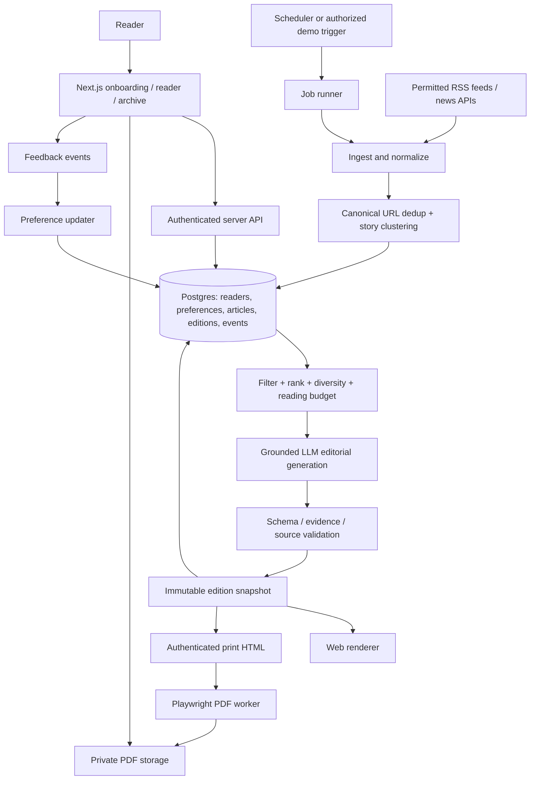

# DAYBREAK — System Architecture & Data Model

DAYBREAK uses a single TypeScript application (Next.js App Router) paired with a dedicated Playwright/Chromium PDF worker and Supabase (Postgres, Auth, and private Storage). One persisted, immutable edition snapshot (`editions.content_json`) drives both the interactive web edition and the print-designed downloadable PDF.

## 1. Architecture Diagram

## 2. Component Breakdown

- **Next.js UI (`UI`)**: Provides the guided 60–90s onboarding flow, the daily newspaper reader, the historical edition archive, and the editable *"My editor"* preference profile.
- **Authenticated Server API (`API`)**: Next.js Route Handlers and Server Actions enforcing authentication and Supabase Row-Level Security (RLS) so Reader A can never access Reader B's editions, events, print route, or PDFs.
- **Supabase Postgres (`DB`)**: Stores shared normalized article metadata separately from private user profiles, preferences, immutable edition snapshots, feedback events, and job records.
- **Scheduler & Job Runner (`S` → `J`)**: Daily cron trigger (converting UTC to reader-local delivery time) and authorized trigger that orchestrates ingestion and idempotent daily edition builds (`user_id + local_date + version`).
- **Ingest, Normalize & Dedup (`F` → `I` → `D`)**: Fetches stories from curated RSS feeds and The Guardian Open Platform API with timeouts and health tracking, normalizes URLs/timestamps, deduplicates by canonical URL and content hash, and clusters related coverage.
- **Filter, Rank & Reading Budget (`R`)**: Scores fresh candidate stories against the reader's explicit and learned preferences, region, reading depth, and time budget (5, 10, or 15 minutes) while enforcing topic and source diversity caps.
- **Grounded LLM Editorial Generation & Validation (`L` → `V`)**: Summarizes shared articles once via Google Gemini (`@google/genai`) behind `src/lib/llm/`, personalizes story selection and *"Why this matters to you"* (Context Lens), and validates output with `zod` schemas, source ID checks, and evidence grounding. Treats all fetched article text as untrusted data.
- **Immutable Edition Snapshot (`E`)**: Persists the complete validated edition payload (`editions.content_json`) and profile snapshot. Both renderers read exclusively from this single snapshot.
- **Web Renderer (`W`) & Authenticated Print HTML (`P`)**: Renders the responsive editorial newspaper webpage and an authenticated A4 print-layout HTML view using locally bundled fonts.
- **Playwright PDF Worker (`B`) & Private PDF Storage (`O`)**: A Node worker running headless Chromium (`page.pdf` with print CSS and `preferCSSPageSize`) that captures the print route and uploads the resulting multi-page newspaper PDF to private Supabase Storage for signed/authenticated download.
- **Feedback Events & Preference Updater (`T` → `Q`)**: Captures explicit reader signals (*more/less like this*, *skip* with optional reason, *save*, and profile edits) and updates learned weights for future editions without mutating already-published snapshots.

## 3. Data Model

Shared article data is kept strictly separate from private reader data, with Row-Level Security (RLS) enabled on all user-owned tables:

- **`profiles`**: `user_id`, `timezone`, `region`, `delivery_time`, `reading_minutes`, `depth`, `onboarding_complete`.
- **`preferences`**: `user_id`, `topic/entity`, `explicit_weight`, `learned_weight`, `origin`, `updated_at`.
- **`sources`**: `id`, `name`, `feed_url`, `permitted_use_notes`, `status`, `last_success_at`.
- **`articles`**: `id`, `canonical_url`, `source_id`, `title`, `published_at`, `fetched_at`, `permitted_excerpt/body`, `content_hash`, `topics`, `optional_embedding`, `cluster_id`, `extraction_status`.
- **`editions`**: `id`, `user_id`, `local_date`, `version`, `state`, `content_json`, `profile_snapshot`, `source_cutoff`, `generated_at`, `pdf_status`, `pdf_storage_key`.
- **`edition_stories`**: `edition_id`, `article_ids`, `position`, `section`, `relevance_reasons` *(can be derived from snapshot if avoiding duplicate storage)*.
- **`feedback_events`**: `id`, `user_id`, `edition_id`, `story_id`, `type`, `optional_reason`, `timestamp`.
- **`jobs`**: `id`, `kind`, `idempotency_key`, `status`, `attempts`, `last_error`, `timestamps`.

### Core Data Invariants
- **Idempotent Daily Generation**: Unique key on `(user_id, local_date, version)`. Repeated scheduler triggers never create duplicate editions.
- **Immutable Snapshots**: Published text is stored directly inside `editions.content_json` rather than pointing to mutable live summaries.
- **Forward-Only Learning**: Reader feedback updates `preferences` to shape future editions (or explicit new `version` regenerations), leaving historical editions untouched.
